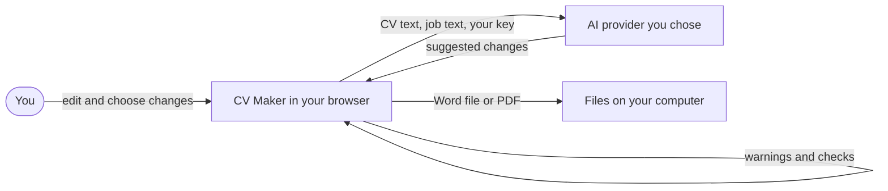

concept

## Introduction

CV Maker is a web app for writing and tailoring a CV. It runs in your browser, keeps your data there, and offers an optional AI assistant that works with your own API key. This document explains the ideas behind those choices, so you can judge whether the app fits your needs and understand what happens to your information. It does not explain how to use the app. For that, see the [tutorial](tutorial-first-cv.md) and the [how-to guides](how-to.md).

## Why the app exists

Many people write a CV only when they need one, and they start from a blank page or an old file. A good CV has a recognised shape. Recruiters expect the newest experience first, achievements rather than duties, and a layout they can scan in seconds. CV Maker puts that shape into a form, so the writer can focus on the content.

The app follows a conventional layout in the Harvard style, which is shown in the app's own title. It offers a plain **Classic** template, which is easy for applicant tracking software to read, and a **With photo** template for people whose employers expect a photo.

## Where your data lives

CV Maker has no server that stores your CV and no user accounts. Your CV is saved in your browser, and a backup is a file you keep yourself.

This design has two consequences:

- **Privacy:** the app does not hold your CV on a server, so there is no central store of CVs to leak.
- **Responsibility:** if you clear your browser data, your CV can be lost unless you have a backup.

The app keeps your work in browser storage, and the interface says it is auto-saved in this browser. It does not sync between devices. Moving a CV to another computer means saving a backup and restoring it there.

## How the AI assistant works

The AI assistant is optional. You bring your own API key from OpenAI, Anthropic or Google Gemini, and the app sends requests directly from your browser to that provider. There is no CV Maker server in between.

Three design choices shape how the assistant behaves:

- **You decide each change.** The assistant suggests edits, and you accept or reject them one by one. Nothing changes in your CV until you accept it.
- **The app checks the answers.** The model's output is checked against the structure of the CV before it reaches you. Contact details, employers, schools and dates of existing entries are protected from change. The job title can only be a title that appears word for word in your job description or your messages.
- **The app warns you about invented facts.** If a suggestion includes a number, or an employer or school that appears nowhere in your material, the app flags it.

The assistant can still make mistakes, and it cannot judge whether an achievement is true. The responsibility for every line stays with you.

## Relationships

CV Maker connects to several ideas, and each one shapes a decision in the app:

- **Recruiting conventions:** reverse-chronological order and action verbs are the defaults in the app's guidance. They come from common practice in hiring, not from any single rule.
- **Applicant tracking systems:** many employers filter CVs with software. The Classic template keeps a plain structure so this software can read it.
- **Browser-based software:** because the app runs in the browser, it works without installation, but it depends on the browser keeping your data.
- **Third-party AI services:** the assistant depends on external providers. Their prices, models and data policies apply to the text you send them.
- **Open-source licensing:** the project is released under the MIT licence, so anyone can read, change and reuse the code.

## Implications

The design brings real benefits and real costs.

**Benefits**

- You can start without an account and without sharing your CV with a company that runs the app.
- Your photo stays in your browser and is never sent to the AI assistant.
- You control which AI provider you use, and you can use the app without any AI at all.

**Costs and limits**

- **Lost data:** without a backup, clearing your browser data can delete your CV. This is the most important limit to understand.
- **No sync:** you move between computers by hand, through backups.
- **AI costs:** the provider charges you directly for the requests you make. Check the provider's prices before you use the assistant heavily.
- **Shared computers:** an API key saved on a shared computer is available to whoever uses that computer. The app stores the key in the browser, so remove it with the reset function after you use a shared machine.
- **Language and layout:** the interface is available in English and Polish. The CV layout follows one template style, which may not suit every country's conventions.

## Summary

CV Maker is designed around three ideas: your CV belongs to you, the AI works for you and not in place of you, and the layout follows common hiring conventions. Your data stays in your browser, so backups matter. The AI assistant is optional and uses your own key. Every change needs your approval.

## Further reading

- [Tutorial: build your first CV](tutorial-first-cv.md), for a guided first CV
- [How-to guides](how-to.md), for specific tasks
- [Contributing](../CONTRIBUTING.md), for developers who want to change the code
- [Diátaxis documentation framework](https://diataxis.fr), the framework behind the document types in this set
- [Code comments](code-comments-document.md), for the design decisions inside the AI modules
