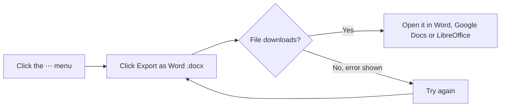
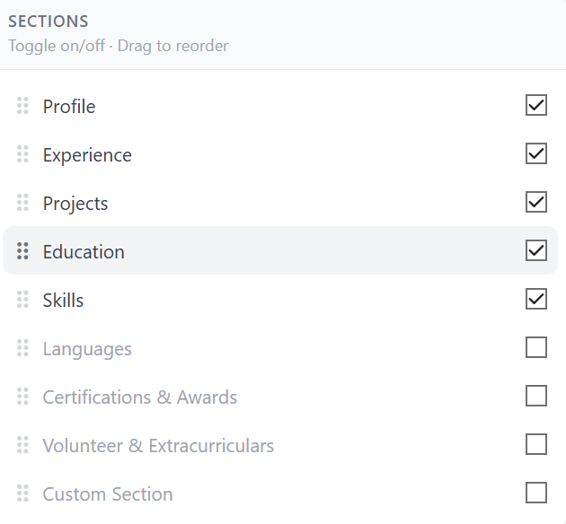
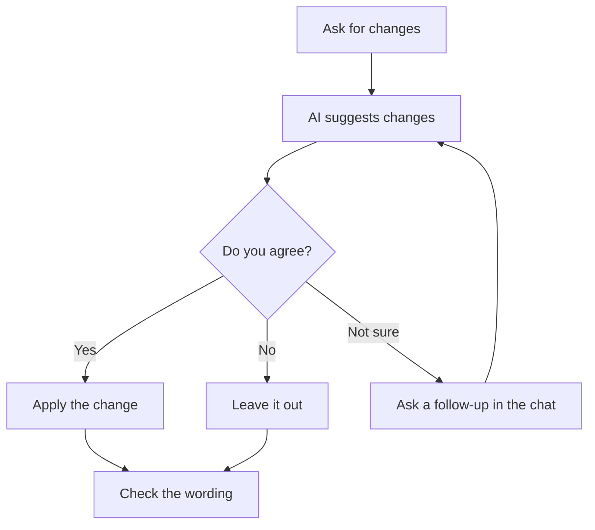

# How-to guides

Each guide solves one problem. Find the guide that matches your goal, then follow its steps from top to bottom.

## On this page

- [Start from an existing CV](#start-from-an-existing-cv)
- [Save a backup of your CV](#save-a-backup-of-your-cv)
- [Restore your CV from a backup](#restore-your-cv-from-a-backup)
- [Export your CV as a Word file](#export-your-cv-as-a-word-file)
- [Save your CV as a PDF](#save-your-cv-as-a-pdf)
- [Show, hide or reorder sections](#show-hide-or-reorder-sections)
- [Add, remove and reorder entries](#add-remove-and-reorder-entries)
- [Undo a change](#undo-a-change)
- [Reset one section](#reset-one-section)
- [Add or remove a photo](#add-or-remove-a-photo)
- [Change the language of the CV headings](#change-the-language-of-the-cv-headings)
- [Save a default CV](#save-a-default-cv)
- [Switch to dark mode](#switch-to-dark-mode)
- [Connect your AI provider with your own API key](#connect-your-ai-provider-with-your-own-api-key)
- [Tailor a CV to a job with the AI assistant](#tailor-a-cv-to-a-job-with-the-ai-assistant)
- [Delete all your CV data](#delete-all-your-cv-data)

Each guide has these parts: **Intro**, **Prerequisites**, **Steps**, **Visuals**, **Example**, **Variations**, **Summary** and **Related links**.

---

## Start from an existing CV

### Intro

Use this guide to move the details of an existing CV into the editor. The app cannot import a PDF or Word CV as a CV. It restores only the `.json` backup file that the app creates. To use another file, you add it as reference material for the AI assistant.

### Prerequisites

- Your existing CV, open on your computer
- The app open in your browser at https://cvmaker.codepapa.xyz

### Steps

**Method 1: Type the details in**

1. Open the editor.
2. Copy each detail from your old CV into the matching field, following the [tutorial](tutorial-first-cv.md).

**Method 2: Give the old CV to the AI assistant**

1. Open the AI assistant. See [Tailor a CV to a job with the AI assistant](#tailor-a-cv-to-a-job-with-the-ai-assistant).
2. Attach your old CV. The app accepts these file types, up to 10 MB:
   - PDF, which reads only the first 30 pages
   - Word (`.docx`)
   - Text (`.txt`)
   - Markdown (`.md`)
   - HTML (`.html`)

   [verify where the attach control is in the AI window]
3. Ask the assistant to fill in the editor from the attached text. Review each suggestion before you accept it.

### Visuals

No screenshot yet. Capture the AI window with the attach control visible, and add it here.

### Example

Priya has a PDF CV from her last job. She types her job titles, companies and dates into the editor. For her education, she uses the same method, then checks every entry against the PDF.

### Variations

- **Scanned PDF:** a scanned PDF has no readable text. Use Method 1.
- **Word file:** a `.docx` file works the same way as a PDF in Method 2.

### Summary

Your CV details now appear in the editor, in the right fields.

### Related links

- [Save a backup of your CV](#save-a-backup-of-your-cv)
- [Tailor a CV to a job with the AI assistant](#tailor-a-cv-to-a-job-with-the-ai-assistant)

---

## Save a backup of your CV

### Intro

Use this guide to save your CV in a file. You can restore the file later or move it to another computer.

### Prerequisites

- Your CV open in the editor

### Steps

1. Click the **⋯ menu** in the header.
2. Click **Save backup**. The app downloads a `.json` file.
3. Move the file to a safe place, such as a cloud folder.

### Visuals

No screenshot yet. Capture the **⋯ menu** with **Save backup** highlighted.

### Example

Before Priya changes the layout of her CV, she saves a backup named *before-layout.json*. [verify the file name the app gives it]

### Variations

- **Another computer:** copy the file to that computer, then [restore it there](#restore-your-cv-from-a-backup).
- **Regular copies:** save a new backup after each big change, and keep the older ones.

### Summary

You now have a `.json` file that holds your CV.

### Related links

- [Restore your CV from a backup](#restore-your-cv-from-a-backup)
- [Save a default CV](#save-a-default-cv)

---

## Restore your CV from a backup

### Intro

Use this guide to replace the CV in the editor with the CV in a backup file.

### Prerequisites

- A `.json` backup file that this app created
- A backup of your current CV, if you want to keep it. Restoring replaces the current CV.

### Steps

1. Click the **⋯ menu** in the header.
2. Click **Restore backup**.
3. Choose the `.json` backup file.
4. Confirm in the message that appears. [verify the button label]

### Visuals

No screenshot yet. Capture the confirmation message.

### Example

Priya's laptop breaks. She opens the app on a new computer and restores *before-layout.json*. Her CV appears as it was.

### Variations

- **Wrong file:** the app shows *Invalid file: please upload a CV Maker .json backup file*. Choose the file you saved from this app.

### Summary

The editor shows the CV from the backup.

### Related links

- [Save a backup of your CV](#save-a-backup-of-your-cv)

---

## Export your CV as a Word file

### Intro

Use this guide to get an editable Word (`.docx`) version of your CV.

### Prerequisites

- Your CV in the editor
- Word, Google Docs or LibreOffice to open the file

### Steps

1. Click the **⋯ menu** in the header.
2. Click **Export as Word (.docx)**.
3. Open the downloaded file in your word processor.

### Visuals

The flowchart above shows the steps and the retry.

### Example

Priya exports her CV as Word so a recruiter can suggest small wording changes. She edits the file in Google Docs and keeps the app's version as her master copy.

### Variations

- **Layout:** a Word file stays editable, but its layout may differ from the preview. Check the layout after you open the file.
- **Fixed layout:** use [Save your CV as a PDF](#save-your-cv-as-a-pdf) when the layout must not change.

### Summary

You now have a Word file that contains your CV.

### Related links

- [Save your CV as a PDF](#save-your-cv-as-a-pdf)

---

## Save your CV as a PDF

### Intro

Use this guide to get a PDF of your CV with a fixed layout. Employers often expect a PDF when you apply.

### Prerequisites

- Your CV in the editor
- A browser print dialog that can save as PDF

### Steps

1. Click **Save PDF** in the header. A print dialog opens.
2. Choose **Save as PDF** as the destination.
3. Set the margins to **None**. The app adds its own margins.
4. Save the file.

### Visuals

No screenshot yet. Capture the print dialog with **Save as PDF** and **None** margins selected.

### Example

Before she sends her CV to a recruiter, Priya saves a PDF, opens it and checks that the margins look right.

### Variations

- **Wrong margins:** the margin setting is not **None**. Change it and save again.
- **Editable text:** use [Export your CV as a Word file](#export-your-cv-as-a-word-file) when the recruiter wants to edit the text.

### Summary

You now have a PDF that matches the preview.

### Related links

- [Export your CV as a Word file](#export-your-cv-as-a-word-file)

---

## Show, hide or reorder sections

### Intro

Use this guide to choose which sections appear on your CV and the order they appear in.

### Prerequisites

- Your CV in the editor

### Steps

1. Scroll down to the **Sections** panel. Its subtitle reads *Toggle on/off · Drag to reorder*.
2. To show or hide a section, tick or untick its checkbox on the right.
3. To change the order, drag a section by its handle, the dots on the left, to a new position.

### Visuals

### Example

A recent graduate ticks Education and drags it above Experience. The preview moves the Education section to the top.

### Variations

- **Empty section:** a ticked section with no entries shows nothing. Add an entry, or untick the section.
- **Projects:** untick Projects if you have none to show.

### Summary

The preview shows the ticked sections, in the order you chose.

### Related links

- [Add, remove and reorder entries](#add-remove-and-reorder-entries)

---

## Add, remove and reorder entries

### Intro

Use this guide to add a job, degree, project or other entry to a section, and to change the order of entries.

### Prerequisites

- The section is ticked in the Sections panel

### Steps

1. In the section, click the add button, such as **+ Add experience**, **+ Add education** or **+ Add project**.
2. Fill in the fields.
3. To move an entry, click **Move up** or **Move down** on that entry.
4. To delete an entry, click **Remove entry** on that entry.

### Visuals

No screenshot yet. Capture one entry with the **Move up**, **Move down** and **Remove entry** controls visible.

### Example

Priya adds a second job. She clicks **Move up** on the new entry, so her most recent job appears first.

### Variations

- **No add button:** tick the section in the Sections panel.
- **Skills:** click **+ Add skill category**, then enter items separated by commas. Skills work differently from other sections.

### Summary

The entry appears in the preview, in the position you chose.

### Related links

- [Show, hide or reorder sections](#show-hide-or-reorder-sections)
- [Undo a change](#undo-a-change)

---

## Undo a change

### Intro

Use this guide to reverse a change you did not mean to make.

### Prerequisites

- A change made in the current session

### Steps

1. Click **Undo** in the header, or press **Ctrl+Z** on Windows or **Cmd+Z** on a Mac.
2. To redo a change, click **Redo**, or press **Ctrl+Shift+Z** or **Cmd+Shift+Z**. [verify the Redo control]

### Visuals

No screenshot yet. Capture the header with **Undo** and **Redo** visible.

### Example

Priya deletes an entry by mistake. She presses Ctrl+Z, and the entry returns to its place.

### Variations

- **Older change:** Undo may not reach far back. To return to an older version, [restore a backup](#restore-your-cv-from-a-backup). [verify how far Undo goes]
- **Keyboard shortcuts:** the shortcuts work only when the editor has focus. [verify]

### Summary

The CV returns to its state before the change.

### Related links

- [Restore your CV from a backup](#restore-your-cv-from-a-backup)

---

## Reset one section

### Intro

Use this guide to clear every entry in one section and start that section again.

### Prerequisites

- The section you want to clear
- A backup, if you want to keep its entries

### Steps

1. Find the section and click **↺ Reset** on it. [verify the button label]
2. Confirm in the message that appears. [verify the button label]

### Visuals

No screenshot yet. Capture a section header with **↺ Reset** visible.

### Example

Priya resets her Languages section to write it again from scratch. Her other sections stay as they were.

### Variations

- **Undo:** Undo may restore the section while the page is open. [verify] Do not rely on it.

### Summary

The section is empty, and the other sections are unchanged.

### Related links

- [Save a backup of your CV](#save-a-backup-of-your-cv)

---

## Add or remove a photo

### Intro

Use this guide to add a photo to your CV or remove it. The photo appears only with the **With photo** template.

### Prerequisites

- A JPG, PNG, WebP or GIF picture under 15 MB

### Steps

1. Under **Template**, choose **With photo**.
2. Click **Upload photo** and choose the picture. [verify the button label]
3. Check the crop in the preview. The app crops the picture to a square from its centre.
4. To replace the photo, click **Change photo**. To remove it, click **Remove**. [verify the button labels]

The photo stays in your browser. The app never sends it to the AI assistant.

### Visuals

No screenshot yet. Capture the Template card with the photo preview.

### Example

Priya uploads a headshot. The preview crops it to a square, and her name and contact details sit beside it.

### Variations

- **Classic template:** choose **Classic** to leave the photo out. The photo stays in your browser but does not appear on the CV.
- **Errors:**
  - *Please choose a JPG, PNG, WebP or GIF picture*: the file type is not supported.
  - *That picture is too large*: the file is over 15 MB.
  - *That file couldn't be read as a picture*: the file is damaged or is not a picture.

### Summary

The preview shows the photo beside your name, or no photo at all.

### Related links

- [Choose a template](tutorial-first-cv.md#step-8-choose-a-template), in the tutorial

---

## Change the language of the CV headings

### Intro

Use this guide to print the CV headings, such as *Experience* and *Education*, in another language. Your own text stays in the language you wrote it in.

### Prerequisites

- Your CV in the editor

### Steps

1. Under **Template**, find **CV language**. [verify the label]
2. Choose a language. **Same as the app** uses the language of the interface.
3. Check the preview.

### Visuals

No screenshot yet. Capture the **CV language** control.

### Example

Priya writes her CV in English but applies to a Polish company. She sets the CV language to Polish. The headings change, and her English text stays the same.

### Variations

- **Polish text:** set **Gender forms in Polish text** so the AI uses the right verb forms. Choose **Detect from my text**, or pick masculine or feminine forms. [verify the labels]

### Summary

The CV headings appear in the language you chose.

### Related links

- [Tailor a CV to a job with the AI assistant](#tailor-a-cv-to-a-job-with-the-ai-assistant)

---

## Save a default CV

### Intro

Use this guide to keep a copy of your CV to start new, tailored versions from.

### Prerequisites

- Your CV in the editor

### Steps

**Save the default**

1. Click the **⋯ menu**, then **Save as default CV**. [verify the menu label]
2. The menu shows when you saved it, as *Saved {date}*.

**Load the default**

1. Click the **⋯ menu**, then **Load default CV**. [verify the menu label]
2. Confirm in the message that appears. [verify the button label]

### Visuals

No screenshot yet. Capture the **⋯ menu** with the default options visible.

### Example

Priya saves her general CV as the default. For each job she applies to, she loads the default and tailors it with the AI assistant.

### Variations

- **Storage full:** the app shows *Could not save the default CV: the browser storage is full or blocked*. Free up browser storage, or use a backup instead.

### Summary

The editor shows the saved default CV.

### Related links

- [Tailor a CV to a job with the AI assistant](#tailor-a-cv-to-a-job-with-the-ai-assistant)
- [Save a backup of your CV](#save-a-backup-of-your-cv)

---

## Switch to dark mode

### Intro

Use this guide to make the app easier to read in low light.

### Prerequisites

- None

### Steps

1. Click the sun or moon button in the header.
2. To switch back, click the button again.

### Visuals

No screenshot yet. Capture the header with the sun or moon button visible.

### Example

Priya works on her CV late in the evening and switches to dark mode.

### Variations

- **Exports:** dark mode changes only the screen. Check that your exported file looks right.

### Summary

The app switches between light and dark colours.

### Related links

- [Save your CV as a PDF](#save-your-cv-as-a-pdf)

---

## Connect your AI provider with your own API key

### Intro

Use this guide to save your API key so the AI assistant can work.

### Prerequisites

You need an API key from one provider:

- OpenAI: platform.openai.com/api-keys
- Anthropic (Claude): console.anthropic.com/settings/keys
- Google Gemini: aistudio.google.com/apikey

Creating a key may require an account. Some providers charge for use, so check their pricing first.

### Steps

1. Click the **⋯ menu**, then **AI settings & API key**. [verify the menu label]
2. Choose your provider.
3. Paste your key into the key field, and save.

### Visuals

No screenshot yet. Capture the AI settings dialog with the provider choice visible. Do not include your key in the screenshot.

### Example

Priya creates a Gemini key, pastes it into the app and uses the AI assistant the same day.

### Variations

- **Different provider:** change the provider later in the same dialog. Each provider has its own key.
- **Shared computer:** do not save your key on a shared computer. Delete it afterwards with [Delete all your CV data](#delete-all-your-cv-data).

### Summary

The AI assistant can now send requests to your provider.

### Related links

- [Tailor a CV to a job with the AI assistant](#tailor-a-cv-to-a-job-with-the-ai-assistant)

**Privacy:** the app stores your key in this browser. Your CV and any job text you attach go to the provider you chose.

**If the AI does not respond:**

- *Authentication error:* the key is wrong or not valid for that provider. Copy it again.
- *Quota error:* the account has no credit or has reached its limit. Check the provider's billing page.
- *Network error:* the request did not reach the provider. Check your connection.
- *Provider busy:* the app retries automatically. If the request still fails, switch model, or cancel and send it again. [verify the retry behaviour]

---

## Tailor a CV to a job with the AI assistant

### Intro

Use this guide to get suggested changes to your CV for one job. You keep only the changes you agree with.

### Prerequisites

- [A connected AI provider](#connect-your-ai-provider-with-your-own-api-key)
- The job description, ready to paste or attach

### Steps

1. Click **AI** in the header. You can also click the **AI** button on a section, or the ✨ on a single job or project.
2. Choose a quick prompt, or type your own request. For example: *Tailor the profile and the first two experience entries to this job.*
3. Paste the job description, or attach it as a file. [verify the attach control]
4. Read the suggested changes. Apply the ones you want, and leave the others.
5. Ask follow-up questions in the chat to refine a suggestion.
6. Check every number, date and name against your own records before you send your CV.

### Visuals

The flowchart above shows the decision for each suggestion. No screenshot of the AI window yet.

### Example

Priya pastes a job ad that asks for Python. She asks the assistant to emphasise Python in her Skills section. The assistant suggests moving Python to the first category, and she accepts it. She rejects a suggested change to her job title, because the change does not match the role she applies for.

### Variations

- **Quick prompt:** use a quick prompt for a common task, such as shortening bullets. Write your own request for anything specific.
- **Busy provider:** switch model, or cancel and send the request again.

### Summary

The changes you chose appear in the CV in the editor.

### Related links

- [Undo a change](#undo-a-change)
- [Connect your AI provider with your own API key](#connect-your-ai-provider-with-your-own-api-key)

**What the AI does not change:** your contact details, and the employers, schools and dates of existing entries. It can remove duplicates and move entries between sections. It sets your job title to the exact title of the job you tailor for.

---

## Delete all your CV data

### Intro

Use this guide to remove everything the app has stored in this browser.

### Prerequisites

- A backup, if you want to keep the CV

### Steps

1. Click the **⋯ menu**, then **Reset all data**. [verify the menu label]
2. Read the warning, and confirm. [verify the button label]

### Visuals

No screenshot yet. Capture the warning message, without any personal data in it.

### Example

Priya finishes her job search and wants to remove her CV from a computer that other people use. She saves a backup, then resets all data.

### Variations

- **Keep the CV:** save a backup first, and restore it later.
- **Only the key:** to remove only your AI key, use the AI settings in [Connect your AI provider with your own API key](#connect-your-ai-provider-with-your-own-api-key). [verify that the key can be removed on its own]

### Summary

The editor is empty, and this browser holds no CV, default CV or AI key.

### Related links

- [Save a backup of your CV](#save-a-backup-of-your-cv)
