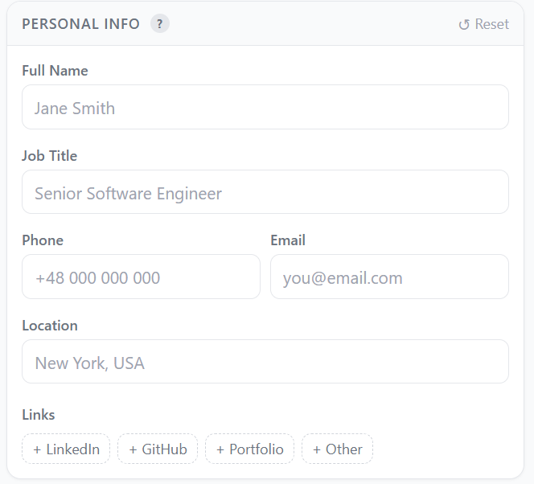

# Tutorial: Build your first CV

## Intro

In this tutorial you build a one-page CV, save a backup, and export it as a Word file and a PDF. You work from top to bottom, in the order the sections appear on the page. Each step tells you what to do, what you should see, and why it matters.

## Prerequisites

- A web browser, such as Chrome, Firefox, Safari or Edge
- Time to complete: 45 minutes
- Your own details, or the sample details in this tutorial

You need no account and no AI key.

## Instructions

### Step 1: Open the app

Go to https://cvmaker.codepapa.xyz. The editor shows a blank CV.

The app saves your work in this browser. Enter something in Step 2, reload the page, and your work remains.

**Why:** the app saves to your browser, not to a server. Your CV stays private, but clearing your browser data deletes it. Step 10 shows you how to make a backup.

### Step 2: Enter your personal details

The first card is **Personal Info**. Fill in:

- **Full Name**, for example *Jane Smith*
- **Job Title**, for example *Senior Software Engineer*
- **Phone** and **Email**
- **Location**, city and country only
- **Links**: click **+ LinkedIn**, **+ GitHub**, **+ Portfolio** or **+ Other**

As you type, your name and job title appear at the top of the preview.

**Why:** recruiters decide within seconds whether to keep reading, so put the information they need first.

### Step 3: Choose your sections

Scroll down to the **Sections** panel. Its subtitle reads *Toggle on/off · Drag to reorder*. Each row has a checkbox on the right and a handle of dots on the left.

By default, five sections are ticked: **Profile**, **Experience**, **Projects**, **Education** and **Skills**. The other four are greyed out.

For this tutorial:

1. Untick **Projects**. The row turns grey, and the section leaves your CV. You will leave it out to keep the tutorial short.
2. Keep **Profile**, **Experience**, **Education** and **Skills** ticked. You fill in each one in the steps that follow.
3. Drag **Education** above **Experience**, and watch the order change. Then drag it back.

**Why:** the section order signals what matters most. A recent graduate often puts education first. An experienced engineer usually puts experience first.

### Step 4: Write your profile

Scroll down to **Profile**. Write two to four sentences: your role first, then your strongest one or two achievements.

For example:

> Backend engineer with five years of experience building payment systems. Focused on reliability and developer tooling.

The bio counter shows how many characters you have written. Your sentences appear under your name as you type.

**Why:** a profile summarises. It does not replace a cover letter, so keep it short.

### Step 5: Add your education

Scroll down to **Education** and click **+ Add education**. Fill in:

- **School / University**
- **Degree** and **Field of Study**
- **Start Date** and **End Date**. Tick **Currently ongoing** for a degree you are still studying.

Your school appears in the preview, with the dates beside it.

Add an earlier degree: click **+ Add education** again. The new entry appears below the first. To move it up, use **Move up** on the entry.

**Why:** recruiters read from the top down and expect the newest information first. This order is called reverse chronological.

### Step 6: Add your experience

Scroll down to **Experience** and click **+ Add experience**. Fill in the job title, company and dates. Then click **+ Add bullet** to describe the work.

Compare two bullets:

- Weak: *Was responsible for the billing system.*
- Stronger: *Rebuilt the billing service, reducing failed payments by 18%.*

Type one bullet of each kind, and compare them in the preview. The stronger bullet states a result. The weak one only describes a duty.

Start each bullet with a past-tense action verb, such as *built*, *reduced* or *led*. Add a number only when it is true. If you have no number, describe the outcome.

Add two to four bullets. Then click **+ Add experience** and add a second role. You have now repeated the same steps for one entry, which you can use for every entry.

**Why:** a bullet that states a result shows what you achieved. A bullet that lists a duty does not.

### Step 7: Add your skills

Scroll down to **Skills**. Each category has a **Category** field and an **Items (comma-separated)** field.

1. Enter a category, such as *Programming Languages*.
2. Enter the items, separated by commas, such as *Python, JavaScript, SQL*.
3. Click **+ Add skill category**, and add a second category, such as *Tools*.

Each category appears in the preview on its own line, with its items after it.

**Why:** recruiters and applicant tracking systems scan this section quickly. Use two to four categories, and list only skills you could discuss in an interview.

### Step 8: Choose a template

Scroll down to **Template** and choose one option:

- **Classic:** a centred name and contact line. Plain, and it works well with applicant tracking systems.
- **With photo:** a photo beside your name and contact details.

Click each option and watch the preview change. A photo you add is cropped to a square and stays in your browser. The app never sends it to the AI.

**Why:** some employers expect a photo, and others do not. Plain layouts are easier for automated systems to read. If you are unsure, choose Classic.

### Step 9: Check the layout

On a wide screen, the editor and preview appear side by side. On a phone, tap **Preview** in the header.

Check that:

- Your name and job title sit at the top
- The sections appear in the order you chose in Step 3
- Projects does not appear
- No section is empty
- Dates match, such as *Sep 2022* and *Jun 2026*

Click **Undo** in the header to reverse a mistake.

**Why:** a CV can look right on screen and still be untidy in print. The preview catches these problems before a recruiter does.

### Step 10: Save a backup

Click the **⋯ menu**, then **Save backup**. The app downloads a `.json` file.

To test the backup, click **⋯ menu**, then **Restore backup**, and choose the file. Your CV should look as it did.

**Why:** your CV lives in this browser. A backup protects it if you clear your browser data, and it moves your CV to another computer.

### Step 11: Export your CV

**Word file:** click the **⋯ menu**, then **Export as Word (.docx)**. Open the file in Word, Google Docs or LibreOffice.

**PDF:** click **Save PDF** in the header. In the print dialog:

1. Choose **Save as PDF** as the destination.
2. Set the margins to **None**. The app adds its own margins.
3. Save the file.

Open the PDF. The margins and layout should match the preview.

**Why:** Word files stay editable. A PDF keeps the layout fixed, which most employers expect.

## Recap

Check that you have:

- [ ] Your name, job title and contact details at the top
- [ ] A profile of three to five sentences
- [ ] Education and experience, most recent first
- [ ] Experience bullets that start with an action verb and, where true, include a number
- [ ] Skills in at least one category
- [ ] Projects switched off, and the other sections in the order you chose
- [ ] A saved backup file
- [ ] A Word file and a PDF that both show your changes

You did a good job. You made the decisions a recruiter looks for: what comes first, what to leave out, and how to show results. Your next CV will take less time.

## What's next

- To tailor your CV to a job, follow the [how-to guide for tailoring a CV](how-to.md#tailor-a-cv-to-a-job-with-the-ai-assistant). You need your own API key from OpenAI, Anthropic or Google Gemini.
- To add Projects, switch it on in the **Sections** panel, and follow Step 6.
- To change how the app works, read [CONTRIBUTING.md](../CONTRIBUTING.md).
